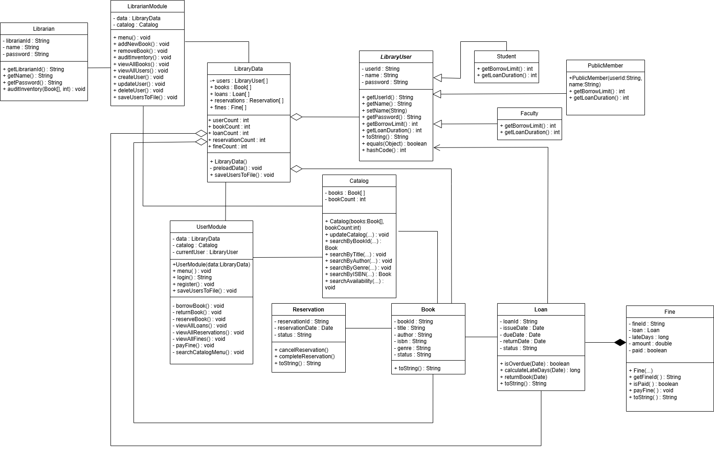

# Smart Library Management System

A Java console-based library management system developed as a group project. It models common library workflows, including user registration and login, book catalog management, borrowing and returning books, reservations, and overdue fines.

## Features

### User Functions
- Register and log in to the system.
- Browse the book catalog.
- Search books by book ID, title, author, genre, ISBN, or availability.
- Borrow and return books.
- Reserve books.
- View loan, reservation, and fine records.
- Pay outstanding fines.

### Librarian Functions
- Add and remove books.
- Audit the book inventory.
- View, create, update, and delete user records.

### Borrowing Rules and Fines
- Different member types have different borrowing limits and loan durations.
- Students: borrow up to 5 books; 14-day loan duration.
- Faculty: borrow up to 10 books; 30-day loan duration.
- Public members: borrow up to 3 books; 7-day loan duration.
- Overdue fines are calculated at RM1 per late day in the current implementation.
- Loan, reservation, and fine records track their statuses.

## Tech Stack

- **Language:** Java
- **Interface:** Command-line / console menu
- **Data persistence:** Local text files
- **Core concepts:** Object-oriented programming, inheritance, encapsulation, abstraction, polymorphism, arrays, file I/O, and date handling

## UML Class Design

The project includes a UML class diagram showing the main classes and relationships, including:

- `LibraryUser` as an abstract base class
- `Student`, `Faculty`, and `PublicMember` as subclasses
- `Book`, `Catalog`, `Loan`, `Reservation`, and `Fine` for library workflows
- `LibraryData` for storing and loading application data
- `UserModule` and `LibrarianModule` for console workflows

```markdown

```

## Project Structure

```text
SmartLibrarySystem/
└── Library/
    ├── Main.java
    ├── LibraryData.java
    ├── LibraryUser.java
    ├── Student.java
    ├── Faculty.java
    ├── PublicMember.java
    ├── Librarian.java
    ├── LibrarianModule.java
    ├── UserModule.java
    ├── Book.java
    ├── Catalog.java
    ├── Loan.java
    ├── Reservation.java
    ├── Fine.java
    ├── users.txt
    ├── books.txt
    ├── loans.txt
    └── reservations.txt
```

The exact files in use may vary by the current version. Keep the text data files required by the program, but remove any real or private information before publishing.

## Requirements

- Java Development Kit (JDK)
- A terminal or Java IDE, such as IntelliJ IDEA, Eclipse, or Visual Studio Code with Java support

## Data and Security Notes

- The application uses local text files rather than a database.
- The current implementation stores user passwords in plain text. This is suitable only as a classroom demonstration; do not use real passwords or real personal information in a public repository.
- Inspect the `.txt` files before publishing and replace any personal or sensitive sample data.
- Compiled `.class` files do not need to be committed; the source `.java` files are sufficient.

## Concepts Demonstrated

- Object-oriented class design and UML modelling
- Abstract classes and inheritance for different library-user types
- Polymorphism through member-specific borrowing rules
- Encapsulation of book, loan, reservation, and fine data
- File input/output for loading and saving records
- Search and catalog management
- Date-based loan due dates and overdue calculations
- Menu-driven application design and input handling

## Future Improvements

Possible improvements include password hashing, stronger input validation, more robust file formats, automated tests, and database integration.
